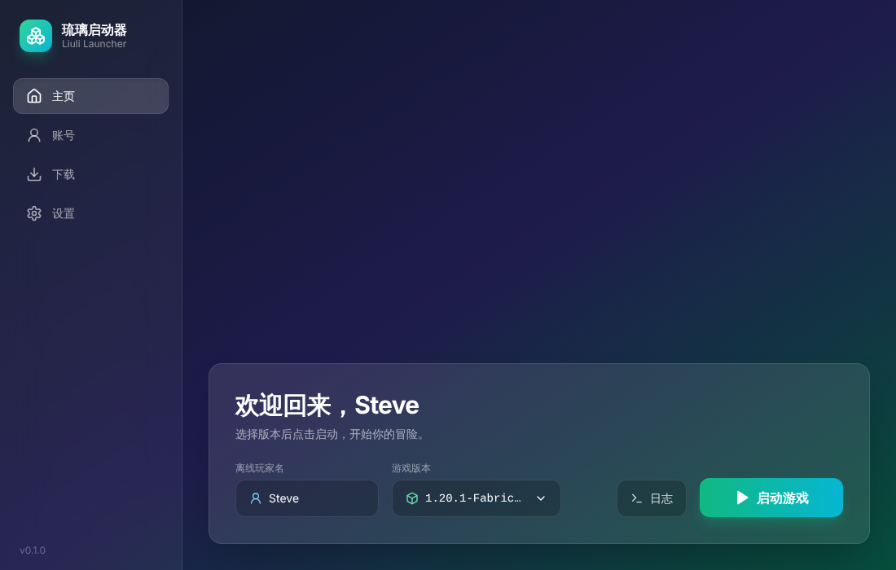
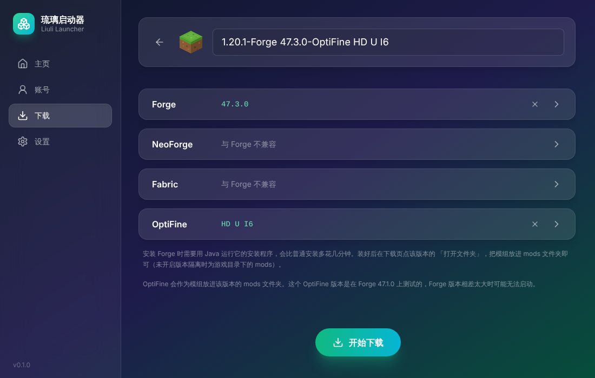
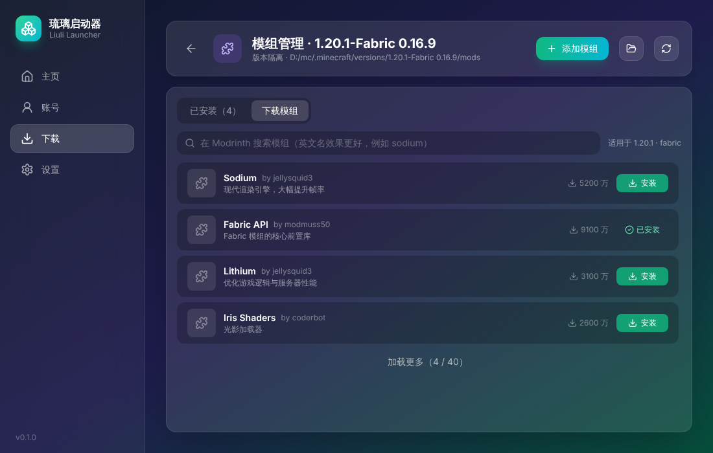
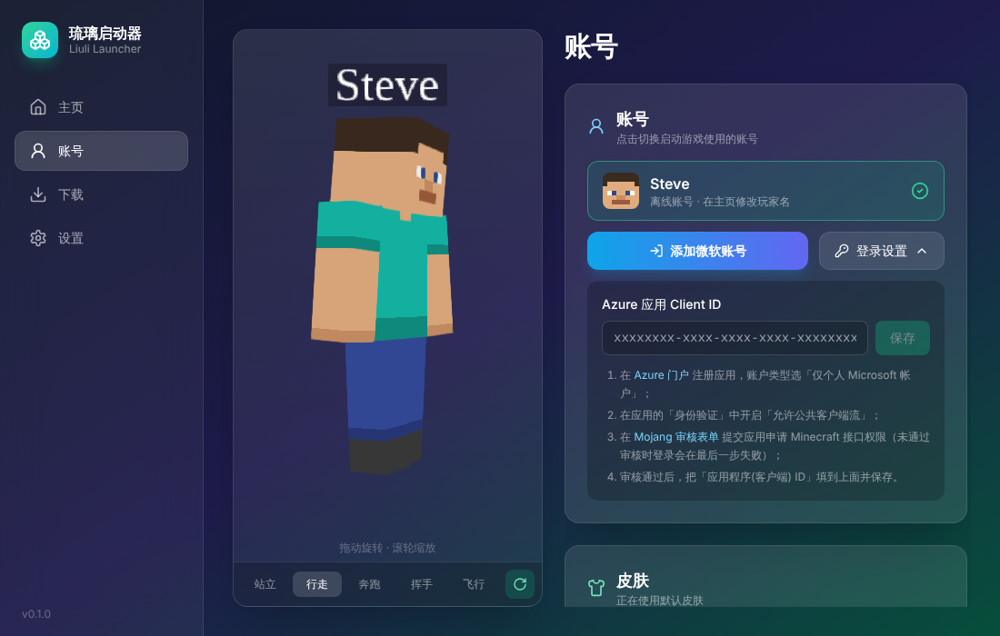

<div align="center">

# 琉璃启动器 · Liuli Launcher

一个界面清爽、开箱即用的 **Minecraft: Java Edition** 启动器

玻璃质感界面 · 深浅色主题 · 国内镜像高速下载 · 模组加载器一键安装 · 微软正版登录

**简体中文** | [English](README.en.md)

</div>



## 功能

### 游戏下载与安装
- 版本列表分为正式版、快照版和远古版，支持搜索
- 两个下载源可选：**BMCLAPI 镜像**（国内推荐）或 **Mojang 官方源**，镜像失败时自动回退到官方
- 多线程下载，实时显示进度和速度；安装过程中可以取消，失败后可以重试
- 安装前可以自定义版本名，并选择要附加的模组加载器：
  - **Forge**、**NeoForge**、**Fabric**（三选一）
  - **OptiFine**（可以单独安装，也可以和 Forge 一起安装）
- **整合包**：在启动器里搜索、筛选并下载 Modrinth 整合包，或导入本地整合包（直接拖进窗口即可）。支持 Modrinth（`.mrpack`）、CurseForge、MultiMC / Prism、MCBBS（`.zip`）格式，自动安装对应的 Minecraft 与模组加载器、下载全部模组并放好配置文件
- 已安装版本可以「检查并修复」，只重新下载缺失或损坏的文件
- 删除版本前会检查是否有其他版本依赖它；版本文件夹里有存档时会特别提醒

### 启动
- **自动选择 Java**：按每个游戏版本的要求挑选合适的 Java，本机没有时自动下载（与官方启动器相同的 Java 运行环境）；也可以在设置中一键下载 Java 8 / 17 / 21 / 25，或手动指定
- 可以设置游戏内存
- 实时游戏日志窗口，支持搜索过滤和一键复制
- **版本隔离**：模组版本（或全部版本）各自使用独立的 `mods`、存档和配置，互不干扰

### 模组管理
- 读取每个模组的名称、版本、简介和图标，支持 Fabric / Quilt / Forge / NeoForge
- 启用或禁用模组（与其他启动器通用的 `.disabled` 方式）；删除的模组会移到回收站
- 标出与当前版本加载器不兼容的模组
- 在启动器里直接 **从 Modrinth 搜索并安装模组**：只显示适用于当前版本的模组，并自动安装必需的前置模组

### 账号
- **离线账号**：可以上传皮肤，用 3D 模型预览，提供多种动作
- **微软正版登录**：在微软官网输入代码完成登录，启动器不接触你的密码；支持多个账号切换，启动时自动续期登录状态

### 界面
- 玻璃质感设计，页面切换动画
- 深色 / 浅色 / 跟随系统 三种主题

| 安装设置 | 模组管理 |
|---|---|
|  |  |



## 快速开始

### 环境要求
- [Node.js](https://nodejs.org/) 20 或更高版本
- 运行游戏需要安装 Java：1.20.5 及以上需要 Java 21，1.18 ~ 1.20.4 需要 Java 17，1.17 需要 Java 16，更早的版本需要 Java 8

### 运行
```bash
git clone https://github.com/xiaoye1001/Liuli-Launcher.git
cd Liuli-Launcher
npm install
npm run dev
```

项目自带 `.npmrc`，Electron 会从国内镜像下载，安装速度更快。

### 其他命令
| 命令 | 作用 |
|---|---|
| `npm run dev` | 开发模式运行（修改代码后自动刷新） |
| `npm run build` | 构建到 `out/` 目录 |
| `npm run typecheck` | TypeScript 类型检查 |
| `npm run build:win` | 同时打包 Windows 安装版与免安装版 |
| `npm run build:win:setup` | 只打包安装版 |
| `npm run build:win:portable` | 只打包免安装版 |
| `npm run build:unpack` | 打包成免安装文件夹（不生成安装程序，用于快速测试） |

### 打包 Windows 版本
在 Windows 上运行：
```bash
npm run build:win
```
完成后在 `dist/` 目录得到两个文件：

| 文件 | 说明 |
|---|---|
| `LiuliLauncher-Setup-<版本号>.exe` | **安装版**：可以选择安装位置，会创建桌面和开始菜单快捷方式；卸载时不会删除你的设置、账号和游戏文件 |
| `LiuliLauncher-Portable-<版本号>.exe` | **免安装版**：单个 exe，双击直接运行；数据保存在 exe 旁边的 `LiuliLauncher-Data` 文件夹，连同 exe 一起复制到 U 盘就能带走 |

免安装版每次启动需要先解压，会比安装版慢几秒。exe 所在位置不可写时（例如放在 `C:\Program Files` 里），数据会改存到与安装版相同的位置。

> 安装包没有代码签名证书，第一次运行时 Windows 可能提示「Windows 已保护你的电脑」，点「更多信息」→「仍要运行」即可。

`build:mac` / `build:linux` 分别用于打包 macOS（dmg）和 Linux（AppImage），需要在对应系统上运行。

## 微软正版登录

Minecraft 的登录接口只允许 **经过 Mojang 审核的 Azure 应用** 使用。Client ID 在**构建时**写入程序，界面中不会显示，也不保存在源码里（避免被他人直接复用）。自己构建时需要先申请一个 Client ID：

1. 登录 [Azure 门户](https://portal.azure.com)，搜索「**应用注册**」→「**新注册**」：
   - 名称：例如 `Liuli Launcher`
   - 受支持的帐户类型：**仅个人 Microsoft 帐户**
   - 重定向 URI：留空
2. 在应用的「**身份验证**」中，把「**允许公共客户端流**」设为「是」并保存（不需要创建客户端密码）
3. 在 [Mojang 审核表单](https://aka.ms/mce-reviewappid) 提交申请，选择 *New AppID for Approval*，并填写「概述」页中的应用程序(客户端) ID 和目录(租户) ID
4. 把项目根目录的 `.env.example` 复制为 `.env`，填入 Client ID：
   ```
   MAIN_VITE_MS_CLIENT_ID=xxxxxxxx-xxxx-xxxx-xxxx-xxxxxxxxxxxx
   ```
   `.env` 已加入 `.gitignore`，不会被提交。之后 `npm run dev` 与打包出的程序都会开启微软登录
5. 用 GitHub Actions 发布时，在仓库的 Settings → Secrets and variables → Actions 中添加名为 `MS_CLIENT_ID` 的 Secret

没有配置 Client ID 时，「添加微软账号」按钮不可用，只能使用离线账号。审核通过前，登录会在最后一步提示「未通过 Mojang 审核」，这是正常的。

## 数据存放位置

免安装版的数据在 exe 旁边的 `LiuliLauncher-Data` 文件夹；安装版与开发模式如下：

| 系统 | 路径 |
|---|---|
| Windows | `%APPDATA%\mc_launcher` |
| macOS | `~/Library/Application Support/mc_launcher` |
| Linux | `~/.config/mc_launcher` |

- `settings.json`：启动器设置
- `accounts.json`：微软账号（登录凭证用系统安全存储加密）
- `.minecraft/`：默认游戏目录（可以在「设置」中改成官方启动器的目录或任意文件夹）
- `cache/`：OptiFine 安装器等缓存

## 技术栈

- [Electron](https://www.electronjs.org/) + [electron-vite](https://electron-vite.org/)
- [React 18](https://react.dev/) + TypeScript + [Tailwind CSS](https://tailwindcss.com/) + [Framer Motion](https://www.framer.com/motion/) + [Lucide](https://lucide.dev/)
- [@xmcl](https://github.com/Voxelum/minecraft-launcher-core-node) 系列库：游戏安装、启动、模组解析、微软登录
- [skinview3d](https://github.com/bs-community/skinview3d)：3D 皮肤预览

```
src/
├── main/        # 主进程：下载安装、启动游戏、账号、模组管理等
├── preload/     # 预加载脚本：向界面暴露 window.api
├── renderer/    # 界面（React）
└── shared/      # 主进程与界面共用的类型定义
```

## 致谢

- [BMCLAPI](https://bmclapi2.bangbang93.com/)：国内下载镜像
- [MCIM](https://mod.mcimirror.top/)：Modrinth 国内镜像
- [Modrinth](https://modrinth.com/)：模组搜索与下载
- [@xmcl / minecraft-launcher-core-node](https://github.com/Voxelum/minecraft-launcher-core-node)
- [skinview3d](https://github.com/bs-community/skinview3d)

## 声明

本项目与 Mojang Studios、Microsoft 没有任何关联。Minecraft 是 Mojang Studios 的商标。请购买正版游戏以支持开发者。

## 许可证

[MIT](LICENSE)
